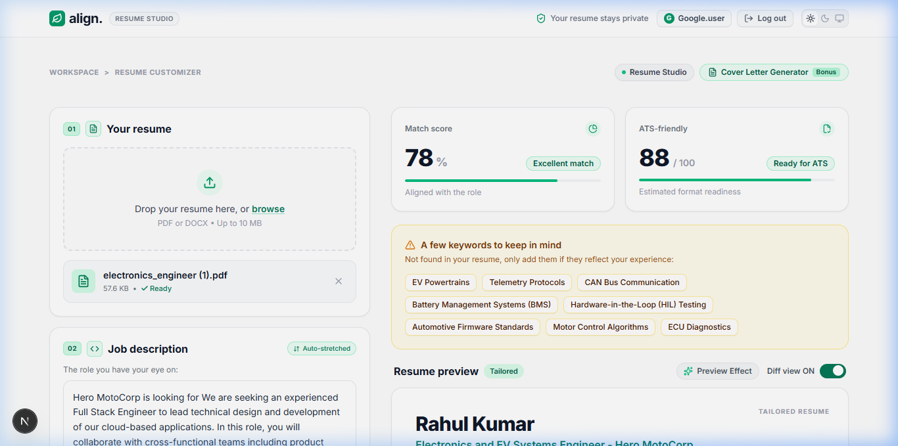
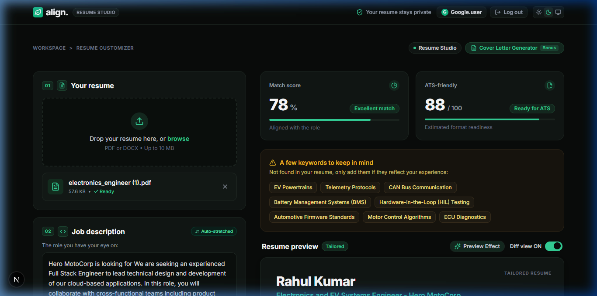
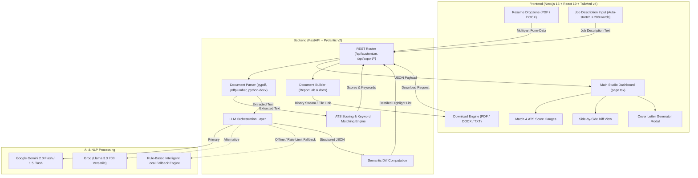

# align. | Resume Studio 🌿

> **Intelligent LLM-Powered Resume Customizer & ATS Optimization Studio**  
> *"Tailor your experience to the right opportunity — truthfully, accurately, and instantly."*

-black?style=flat&logo=next.js)


---

## 📸 Screenshots

| Light Mode (Clean Studio) | Dark Mode (Obsidian Mint) |
| :---: | :---: |
|  |  |

---

## 📌 Project Overview

**align. Resume Studio** is a full-stack AI web application engineered to solve the job application mismatch problem. Candidates often struggle to present their existing skills and experience in the specific terminology and structure required by target Job Descriptions (JDs), frequently getting filtered out by Applicant Tracking Systems (ATS).

**align.** bridges this gap by:
1. Extracting and parsing candidates' resumes from **PDF** or **DOCX** files.
2. Analyzing any target **Job Description** with real-time length indicators and keyword density.
3. Using state-of-the-art **LLMs** (Google Gemini 2.0 Flash / Groq Llama 3.3) to truthfully rewrite career summaries and highlight relevant experience bullets while strictly forbidding hallucination of false qualifications.
4. Generating real-time **Match Scores (%)**, **ATS Readiness Scores (0-100)**, **Interactive Diff Comparisons**, and **Missing Keywords Radars**.
5. Providing **multi-format 1-click exports** (PDF via ReportLab, DOCX, and TXT).

---

## 📂 Repository Structure

The codebase is organized into cleanly separated `frontend/` and `backend/` directories:

```text
resume_ai/
├── backend/                        # Python FastAPI Backend
│   ├── app/
│   │   ├── api/
│   │   │   └── routes.py           # REST endpoints (/api/customize, /api/export/*, etc.)
│   │   ├── core/
│   │   │   └── config.py           # Pydantic BaseSettings & environment loader
│   │   ├── models/
│   │   │   └── schemas.py          # Strict Pydantic models for request/response validation
│   │   ├── services/
│   │   │   ├── ats_scorer.py       # ATS readability & keyword density scoring engine
│   │   │   ├── diff_engine.py      # Line-by-line diff tracking between original and tailored text
│   │   │   ├── document_parser.py  # PDF (pypdf, pdfplumber) and DOCX (python-docx) extraction
│   │   │   ├── exporter.py         # Formatted PDF (ReportLab), DOCX, and TXT file builders
│   │   │   ├── fallback_engine.py  # Offline-resilient rule-based NLP customization engine
│   │   │   └── llm_service.py      # Multi-provider LLM orchestrator (Gemini & Groq)
│   │   └── main.py                 # FastAPI application factory & CORS configuration
│   ├── .env.example                # Template for backend environment variables
│   └── requirements.txt            # Python dependencies
│
├── frontend/                       # Next.js 16 (App Router) Frontend
│   ├── src/
│   │   ├── app/
│   │   │   ├── api/download/       # Direct-download and file preparation API routes
│   │   │   ├── login/              # Protected authentication & login gate page
│   │   │   ├── globals.css         # Tailwind v4 styles, HSL tokens, and themes
│   │   │   ├── layout.tsx          # Root layout with blocking anti-FOUC theme script
│   │   │   └── page.tsx            # Main interactive Studio dashboard
│   │   ├── components/
│   │   │   ├── ui/                 # Reusable UI primitives (Aceternity loader, buttons, inputs)
│   │   │   ├── CoverLetterModal.tsx# AI Cover Letter generator modal (Bonus feature)
│   │   │   ├── DownloadBar.tsx     # Format selector (PDF/DOCX/TXT) with direct URL trigger
│   │   │   ├── JobDescriptionInput.tsx # Auto-stretching textarea (up to 208 words) with counter
│   │   │   ├── KeywordsAlert.tsx   # Missing keywords radar with interactive chips
│   │   │   ├── Navbar.tsx          # Top branding, user session, and theme toggle
│   │   │   ├── ResumePreview.tsx   # High-fidelity document view with diff toggle & scanning beam
│   │   │   ├── ResumeUpload.tsx    # Drag-and-drop resume dropzone with file inspection
│   │   │   └── ScoreCards.tsx      # Match score and ATS readiness visual progress dials
│   │   └── lib/
│   │       ├── api.ts              # Typed API client connecting to backend endpoints
│   │       ├── types.ts            # Shared TypeScript data models
│   │       └── useTheme.ts         # Zero-flicker theme management & OS preference sync hook
│   ├── package.json                # Frontend dependencies and Next.js scripts
│   ├── tsconfig.json               # TypeScript configuration
│   └── next.config.ts              # Next.js bundler settings
│
├── docs/                           # Documentation assets
│   └── screenshots/                # Visual previews for GitHub repository
├── .gitignore                      # Comprehensive git ignore (Node, Python, .env, venv)
├── README.md                       # Full documentation and setup guide
└── run.bat                         # 1-click Windows development launcher
```

---

## 🏛️ System Architecture



---

## 🤖 LLM Providers & Models Used

The system is architected with a pluggable LLM orchestration pipeline:

| Provider | Model | Usage & Role |
| :--- | :--- | :--- |
| **Google Gemini** *(Primary)* | `gemini-2.0-flash` / `gemini-1.5-flash` | Ultra-fast JSON-mode structured inference, objective rewriting, and experience bullet tailoring. |
| **Groq** *(Alternative)* | `llama-3.3-70b-versatile` | Ultra-low latency open-weights inference option for high-throughput environments. |
| **Local NLP Engine** *(Built-in Fallback)* | Rule-based semantic extraction | Offline-resilient fallback engine ensuring zero downtime if API keys are missing or provider quotas are exceeded. |

---

## 💻 Tech Stack

### Frontend
- **Framework**: [Next.js 16](https://nextjs.org/) (App Router, React 19)
- **Styling**: [Tailwind CSS v4](https://tailwindcss.com/) with custom CSS variables
- **Icons**: [Lucide React](https://lucide.dev/)
- **Micro-Animations**: Canvas-Confetti, CSS pulse waves, Aceternity-inspired scan beams
- **Theme Engine**: Custom zero-FOUC hook (`useTheme`) supporting Light, Dark, and System modes

### Backend
- **Framework**: [FastAPI](https://fastapi.tiangolo.com/) with asynchronous request handling
- **Validation**: [Pydantic v2](https://docs.pydantic.dev/) schemas
- **PDF Extraction**: `pypdf` & `pdfplumber` (dual-engine fallback)
- **DOCX Extraction & Creation**: `python-docx`
- **PDF Document Generation**: `ReportLab` with dynamic font sizing and margin calculation
- **HTTP Client**: `httpx` (async)

---

## 🛠️ Local Setup & Run Instructions

### Prerequisites
- **Node.js** v18+ and **npm**
- **Python** 3.10+
- (Optional) Free **Google Gemini API Key** from [Google AI Studio](https://aistudio.google.com/)

---

### Option A: 1-Click Launch (Windows)
Double-click `run.bat` in the project root. It will automatically:
1. Create and activate the Python virtual environment (`.venv`).
2. Install Python dependencies.
3. Install frontend npm packages.
4. Launch both the backend on port `8000` and frontend on port `3000`.

---

### Option B: Manual Setup

#### Step 1: Clone Repository
```bash
git clone https://github.com/kumarplayground/resume_ai.git
cd resume_ai
```

#### Step 2: Backend Setup
```bash
cd backend

# Create virtual environment
python -m venv .venv

# Activate virtual environment
# Windows:
.venv\Scripts\activate
# macOS / Linux:
source .venv/bin/activate

# Install dependencies
pip install -r requirements.txt

# Create .env from template
copy .env.example .env     # Windows
# cp .env.example .env     # macOS / Linux

# (Optional) Add your Gemini API key in .env:
# GEMINI_API_KEY=your_gemini_api_key_here

# Start FastAPI server
python -m uvicorn app.main:app --host 127.0.0.1 --port 8000 --reload
```
*Backend runs at `http://127.0.0.1:8000`. Interactive OpenAPI documentation available at `http://127.0.0.1:8000/docs`.*

#### Step 3: Frontend Setup
In a separate terminal window:
```bash
cd frontend

# Install dependencies
npm install

# Start Next.js development server
npm run dev
```
*Frontend runs at `http://localhost:3000`.*

---

## ⚙️ Key Technical Solutions & Edge-Case Handling

1. **Anti-FOUC Theme Architecture**:
   - Eliminated the initial dark mode flash on page load by implementing a blocking synchronous inline script in `<head>` that evaluates both `localStorage` and `(prefers-color-scheme: dark)` before the initial paint.
2. **Cross-Browser Direct Download Pipeline**:
   - Solved the Chrome blob UUID download bug by transitioning to an authenticated two-phase download handshake (`/api/export/prepare` + direct HTTP response `/api/download/file/*`), guaranteeing correct filenames (`Rahul_Kumar_Resume.pdf`) and extensions across Chrome, Edge, Safari, and Firefox.
3. **Dynamic Job Description Auto-Stretch**:
   - The JD paste textarea dynamically expands its height to fit pasted text, capped at a maximum stretch ceiling of **208 words** with a 1-click trim helper to keep layouts compact while offering full readability.
4. **Resilient Local NLP Fallback**:
   - Guarantees 100% application availability even when no external API key is provided or during third-party LLM rate-limit events.

---

## ⚠️ Known Limitations & Trade-Offs

1. **Scanned Image-Only PDFs**:
   - Text parsing currently targets text-encoded PDF and DOCX files. Scanned document images without embedded OCR text streams require an OCR pre-processor (such as Tesseract), which is omitted to keep backend dependencies lightweight.
2. **LLM Rate Limits on Free Tier**:
   - Free-tier Google Gemini keys carry requests-per-minute (RPM) limits. The system handles this gracefully by automatically failing over to the rule-based local engine.
3. **Layout Flattening for ATS Readability**:
   - Complex multi-column graphic resumes are normalized into a standardized single-column chronological structure, deliberately prioritizing ATS parser compliance over decorative layout complexity.

---

## 📄 License
This project is open-source and available under the [MIT License](LICENSE).
